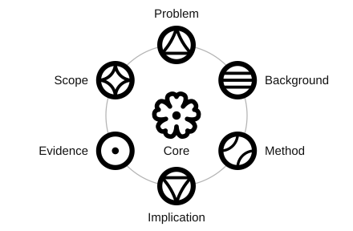

# BNITZ rules

BNITZ is inspired by Rhetorical Structure Theory (RST).

## Legend

| Symbol | Role | Definition |
| --- | --- | --- |
|  | **Core** | The paper’s main contribution. It can be a finding, theorem, argument, synthesis, artifact, guideline, or research plan. |
|  | **Problem** | States the question, gap, or practical problem the parent addresses. |
|  | **Background** | Gives prior work, definitions, or other context needed to understand the parent. |
|  | **Method** | Describes how the parent’s result was obtained or how its proposed work would be carried out. |
|  | **Implication** | States what follows from the parent, such as a prediction, an application, a next step, or a higher-level consequence. |
|  | **Evidence** | Uses results, analyses, or comparisons to support, challenge, or assess the parent. |
|  | **Scope** | Specifies where, when, or under what conditions the parent applies, including limitations and assumptions. |

## Examples

The best way to learn the rules is to explore practical examples in the [BNITZ Reader](https://bnitz.org/). You can find more examples in the [archive](archive/).
