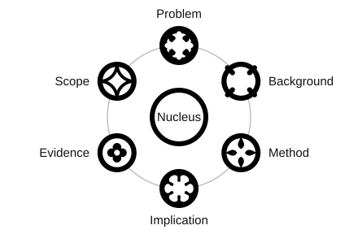

# BNITZ rules

BNITZ is inspired by Rhetorical Structure Theory (RST).

## Legend

| Symbol | Role | Definition |
| --- | --- | --- |
| ○ | **Nucleus** | The paper’s main contribution. It can be a finding, theorem, argument, synthesis, artifact, guideline, or research plan. |
|  | **Problem** | States the question, gap, or practical problem the parent addresses. |
|  | **Background** | Gives prior work, definitions, or other context needed to understand the parent. |
|  | **Method** | Describes how the parent’s result was obtained or how its proposed work would be carried out. |
|  | **Implication** | States what follows from the parent, such as a prediction, an application, a next step, or a higher-level consequence. |
|  | **Evidence** | Uses results, analyses, or comparisons to support, challenge, or assess the parent. |
|  | **Scope** | Specifies where, when, or under what conditions the parent applies, including limitations and assumptions. |

## Heuristic rules

1. First thing: ask what you would cite the paper for. Use that contribution as the **Nucleus**.
2. If a passage gives context and identifies a question, gap, or difficulty the parent addresses, label it **Problem**. Priviledge it over **Background** when in doubt. [Example](https://bnitz.org/#readings/the_geometry_of_truth_emergent_linear_structure_in_llm_representations_of_true_false_datas.bnitz)
3. **Method** answers “How did the authors get this result?” **Evidence** answers “What observation or check supports it?” Attach Evidence to the **Nucleus** when it supports the main contribution, even if it comes from the Method. [Example](https://bnitz.org/#readings/inference_time_intervention_eliciting_truthful_answers_from_a_language_model.bnitz). If it directly supports a claim in the **Method** planet, attach it there. [Example](https://bnitz.org/#readings/progress_measures_for_grokking_via_mechanistic_interpretability.bnitz)
4. **Scope** can be easy to miss. Use it if leaving out a condition, assumption, or limitation would make the parent’s claim sound broader or stronger than the paper supports. [On the Psychophysical Law](https://bnitz.org/#readings/on_the_psychophysical_law.bnitz) · [Bitcoin](https://bnitz.org/#readings/bitcoin_a_peer_to_peer_electronic_cash_system.bnitz)

## Highlighting

Highlight the words that carry a planet’s main point. Include only the context needed to understand it.

## Nesting

Add a planet if and only if it adds anything the rest of the map needs. Attach each planet to the point it directly supports, explains, or qualifies. Choose its relation based on what it does for that parent. The relation applies to the whole branch, including any children. Roles can be left empty.

Give a limitation or assumption its own Scope planet when it needs separate attention, and fold brief qualifiers into the parent.
