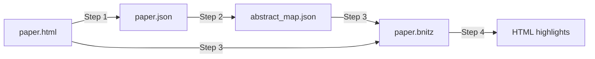

# BNITZ Chrome extension

Open the paper’s arXiv HTML page and click BNITZ in the Chrome toolbar. Select a planet to highlight its passages in the abstract and body. The right-edge tracker shows where to scroll for each highlight. **Export paper map** downloads the v3arxiv `.bnitz` file.

To see the model’s one-sentence explanation of a mapping choice, inspect the side panel and look for **Decision note** in the DevTools Console.

1. Chrome extracts the metadata, abstract, and ordered body blocks into a `paper.json` document in memory. It uses the same text extraction rules for the title and abstract. The body keeps main-text headings and list markers and skips navigation, bylines, notes, the bibliography, appendices, and acknowledgements. Appendix and acknowledgement headings also identify ordinary sections to skip. The `source` URL includes the arXiv version recorded on the page.
2. The Worker maps the abstract from `paper.json` with an LLM using the [prompt](worker/recipes.mjs) and [worked examples](worker/abstract-map-examples.json). It verifies the highlights and planet tree and holds `abstract_map.json` in memory for Step 3.
3. The Worker sends the planets, their abstract highlights, and all the ordered body blocks from `paper.html` to the LLM. The [worked example](worker/body-passage-examples.json) shows how to select passages. The Worker checks each proposed highlight against its named block and assembles `paper.bnitz` with the versioned arXiv ID, planet map, and abstract and body ranges. If either generation step fails, the Worker returns an error.
4. Selecting a planet uses the page’s extracted text positions to paint its highlights and update the tracker.

## Worker

The [Cloudflare Worker](worker/index.mjs) exposes a single HTTP endpoint, `POST /v1/paper-map`. Chrome sends one request to it for both abstract mapping and body highlighting. The Worker keeps the OpenRouter key server-side, rate-limits model calls, and caches the completed `.bnitz` file for up to 30 days per arXiv revision. A cache hit requires the same extracted text and skips both model calls. See the [privacy policy](PRIVACY.md).

## Build

Run `npm run build` from `extension/` and load `extension/dist` as an unpacked extension. Chrome 116 or later is required for [the side panel](https://developer.chrome.com/docs/extensions/reference/api/sidePanel#method-open).

Run `npm test` from `extension/` for the automated Worker checks.

See the [Worker error reference](ERRORS.md) and [manual release checklist](PREFLIGHT_CHECKLIST.md).

For local Worker testing, set `OPENROUTER_API_KEY` in `extension/.dev.vars`, run `npx wrangler dev`, and build with `BNITZ_WORKER_ORIGIN=http://127.0.0.1:8787 npm run build`.
