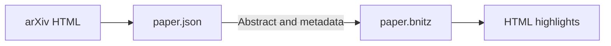

# BNITZ Chrome extension

Open the paper’s arXiv HTML page and click BNITZ in the Chrome toolbar. Select a planet to highlight its excerpts in the abstract.

1. Chrome extracts, from the arXiv HTML, the abstract and ordered body blocks into a `paper.json` document in memory. It skips navigation, bylines, notes, and the bibliography, and retains section headings and appendices.
2. The Worker maps, via an LLM, the abstract with the [prompt](worker/recipes.mjs) and [worked examples](worker/abstract-map-examples.json). It verifies the quotes and planet tree and returns a v3 `.bnitz` document. The body stays in Chrome.
3. Selecting a planet matches the `.bnitz` document to the open abstract and paints its highlight ranges. **Export abstract map** downloads the same document.

## Worker

The [Cloudflare Worker](worker/index.mjs) keeps the OpenRouter key server-side, limits model requests, and caches validated map ranges and relations for up to 30 days. See the [privacy policy](PRIVACY.md).

## Build

Run `npm run build` from `extension/` and load `extension/dist` as an unpacked extension. Chrome 116 or later is required for [the side panel](https://developer.chrome.com/docs/extensions/reference/api/sidePanel#method-open).

For local Worker testing, set `OPENROUTER_API_KEY` in `extension/.dev.vars`, run `npx wrangler dev`, and build with `BNITZ_WORKER_ORIGIN=http://127.0.0.1:8787 npm run build`.
