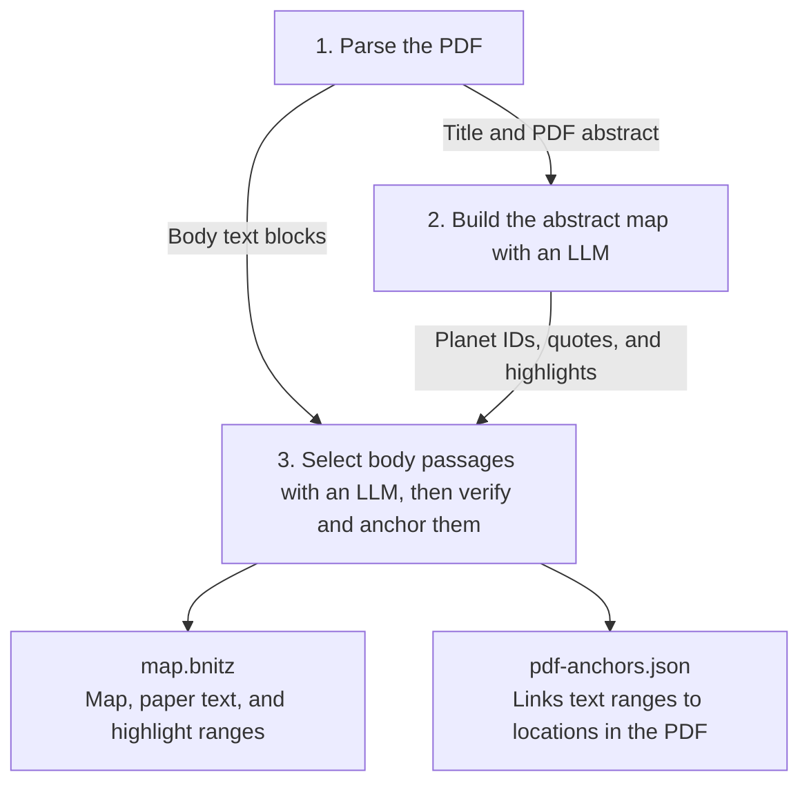

# BNITZ Chrome extension

Open an arXiv PDF and click the BNITZ toolbar icon. BNITZ loads the full PDF and maps the abstract. Select a planet to highlight its related passages throughout the paper.



## Pipeline

### Step 1

PDF.js returns text fragments and their positions for each paper PDF's page. BNITZ joins the fragments and searches the first three pages for one exact match to the full arXiv abstract after normalizing both texts. If it finds a match, it uses the following lines as the body. Otherwise, makes an LLM call to select the abstract and body lines. `prime-cvd/` paper is an example in which the match is found, while `attention-is-all-you-need` is an example in which the match is not found and therefore the fallback route is required.

`01-parse.json` captures the extracted abstract, body blocks, and their PDF positions.

### Step 2

BNITZ sends `article.title` as `title` and `article.text` as `abstract` from `01-parse.json`, alongside mapping instructions and examples. The resulting `02-abstract-map.bnitz` maps the PDF abstract.

### Step 3

BNITZ sends each `body[].text` from `01-parse.json` as a numbered `{id, text}` block, plus the title and each planet’s ID, abstract quote, and highlight phrases from step 2. The LLM selects up to three passages per planet. BNITZ verifies the quotes and saves the map and PDF anchors.

| Step | [PRIME-CVD](https://arxiv.org/abs/2603.19299v1) · Default | [Attention Is All You Need](https://arxiv.org/abs/1706.03762v7) · Fallback |
| --- | --- | --- |
| 1. Parse | [Output](artifacts/prime-cvd/01-parse.json) | [Output](artifacts/attention-is-all-you-need/01-parse.json) · [Fallback exchange](artifacts/attention-is-all-you-need/01-extraction-exchange.json) |
| 2. Map | [Abstract map](artifacts/prime-cvd/02-abstract-map.bnitz) · [Exchange](artifacts/prime-cvd/02-map-exchange.json) | [Abstract map](artifacts/attention-is-all-you-need/02-abstract-map.bnitz) · [Exchange](artifacts/attention-is-all-you-need/02-map-exchange.json) |
| 3. Highlight | [Exchange](artifacts/prime-cvd/03-passage-exchange.json) · [Map](artifacts/prime-cvd/map.bnitz) · [Anchors](artifacts/prime-cvd/pdf-anchors.json) | [Exchange](artifacts/attention-is-all-you-need/03-passage-exchange.json) · [Map](artifacts/attention-is-all-you-need/map.bnitz) · [Anchors](artifacts/attention-is-all-you-need/pdf-anchors.json) |

## Local setup

From `extension/`, using Node 22.13 or later, build the extension:

```sh
npm ci --omit=optional
npm run build
```

The build uses the deployed Worker by default. To use a local Worker, set `OPENROUTER_API_KEY` in `extension/.dev.vars`, run `npx wrangler dev` from `extension/`, and build with `BNITZ_WORKER_ORIGIN=http://127.0.0.1:8787 npm run build`.

In Chrome 151 or later, enable **Developer mode** at `chrome://extensions` and select `extension/dist` with **Load unpacked**. See [Routing](ROUTING.md) for deployment and the Chrome Web Store build.
